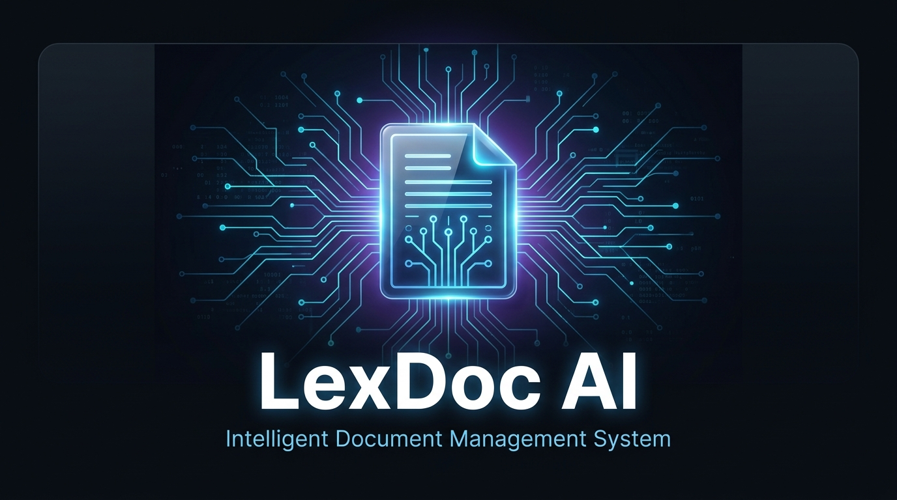

<p align="center">
  
</p>

<h1 align="center">LexDoc AI</h1>

<p align="center">
  <strong>Intelligent Multi-Modal College Document Management System</strong>
</p>

<p align="center">
  <a href="https://github.com/ARJuice/LexDoc-AI/commits/main">
    
  </a>
  <a href="https://github.com/ARJuice/LexDoc-AI/blob/main/LICENSE">
    
  </a>
  
  
  
</p>

<p align="center">
  
  
  
</p>

---

## 🧠 What is LexDoc AI?

**LexDoc AI** is a production-grade, AI-powered document management platform built for college institutions. It's not just a file storage tool — it's an **organizational knowledge platform** that transforms raw institutional documents into structured, searchable, AI-summarized intelligence.

> Built as a college PBL (Project-Based Learning) project, but engineered to production standards.

The system allows students, teachers, HODs, and admins to **upload, access, and understand** documents through AI-generated summaries, smart tagging, and a beautiful glassmorphism UI — all secured by database-level access control.

---

## ✨ Key Features

<table>
<tr>
<td width="50%">

### 🔐 Hybrid Authentication
- Google OAuth for institutional email verification
- Username/Password secondary layer
- Supabase-enforced email domain restrictions
- Role-based access: Admin → HOD → Teacher → Student

</td>
<td width="50%">

### 🤖 AI Document Intelligence
- LlamaParse + OCR.space for multi-modal text extraction
- OpenRouter-powered summarization with 4-model fallback chain
- Auto event parsing (deadlines, schedules) via Gemini 2.0 Flash
- AI-generated summaries cached server-side

</td>
</tr>
<tr>
<td width="50%">

### 🏛️ Database-Layer Security
- PostgreSQL Row Level Security (RLS) policies
- 3NF-normalized schema with junction tables
- DB-level audit triggers (bypassing frontend entirely)
- Automated document expiry via `pg_cron`

</td>
<td width="50%">

### 🎨 Liquid Glass UI
- Custom cursor system with magnetic effects
- GSAP-powered micro-animations and page transitions
- Lenis smooth scroll integration
- Full dark/light theme with CSS variables

</td>
</tr>
</table>

---

## 🏗️ System Architecture

```
┌─────────────────────────────────────────────────────────────────┐
│                         FRONTEND (React 19 + Vite)              │
│  ┌─────────┐  ┌──────────┐  ┌─────────┐  ┌──────────────────┐ │
│  │Dashboard│  │Documents │  │  Upload  │  │   AI Insights    │ │
│  └─────────┘  └──────────┘  └─────────┘  └──────────────────┘ │
│  ┌─────────────────────────────────────────────────────────┐    │
│  │  Redux Store  │  React Router v7  │  Supabase JS SDK    │    │
│  └─────────────────────────────────────────────────────────┘    │
└─────────────────────────────────────────────────────────────────┘
                              │
                    Supabase Client SDK
                              │
┌─────────────────────────────────────────────────────────────────┐
│                         SUPABASE BACKEND                        │
│  ┌──────────────┐  ┌────────────────┐  ┌───────────────────┐   │
│  │  PostgreSQL  │  │  Supabase Auth │  │  Supabase Storage │   │
│  │  (RLS + 3NF) │  │  (OAuth + JWT) │  │  (File Buckets)   │   │
│  └──────────────┘  └────────────────┘  └───────────────────┘   │
│  ┌─────────────────────────────────────────────────────────┐    │
│  │              Edge Functions (Deno Runtime)               │    │
│  │  ┌─────────────────────┐  ┌────────────────────────┐   │    │
│  │  │  generate-summary   │  │     parse-docx         │   │    │
│  │  │  (OpenRouter API)   │  │  (mammoth + cheerio)   │   │    │
│  │  └─────────────────────┘  └────────────────────────┘   │    │
│  └─────────────────────────────────────────────────────────┘    │
└─────────────────────────────────────────────────────────────────┘
                              │
              ┌───────────────┴────────────────┐
              │        External AI APIs         │
              │  LlamaParse │ OpenRouter        │
              │  OCR.space  │ Gemini 2.0 Flash  │
              └─────────────────────────────────┘
```

---

## 🤖 AI Pipeline — How Summarization Works

When a user uploads a document, this happens automatically:

```
Upload Document
    │
    ▼
Store in Supabase Storage
    │
    ▼
Invoke Edge Function: generate-summary
    │
    ├── Check ai_cache → Return instantly if cached
    │
    ▼
Extract Text
    ├── .docx → parse-docx Edge Fn (mammoth + cheerio)
    ├── .pdf  → LlamaParse API
    └── Fallback → OCR.space API
    │
    ▼
AI Summarization (Sequential Fallback Chain)
    ├── 1. arcee-ai/trinity-large-preview:free  (Primary)
    ├── 2. google/gemini-2.0-flash:free          (Fallback 1)
    ├── 3. meta-llama/llama-3.3-70b:free        (Fallback 2)
    └── 4. deepseek/deepseek-chat:free           (Fallback 3)
    │
    ▼
UPSERT into ai_cache + summaries table
    │
    ▼
UPDATE documents.processing_status = 'summarized'
    │
    ▼
Display to User in Real-Time
```

Each AI call has a **45-second AbortController timeout** to prevent runaway edge function billing.

---

## 🗄️ Database Architecture

The PostgreSQL schema is fully normalized to **Third Normal Form (3NF)** with Supabase Row Level Security enforced at every table.

```sql
-- Core Tables
departments    → id, name, code
roles          → id, name, access_level
users          → id, google_id, dept_id(FK), role_id(FK), sr_no, class, semester
documents      → id, title, uploader_id(FK), access_level, processing_status, expiry_date

-- Junction Tables (2NF compliance)
document_tags       → doc_id(FK), tag_id(FK)
document_departments → doc_id(FK), dept_id(FK)

-- AI & Audit
summaries      → id, doc_id(FK), content, model_used
ai_cache       → id, doc_id(UNIQUE FK), summary_text, model_used
audit_logs     → id, user_id(FK), doc_id, action, details, timestamp
notifications  → id, user_id(FK), doc_id(FK), message, is_read
```

### 🔒 Security Highlights

- **RLS on every table** — queries are scoped to the authenticated user's JWT context
- **AFTER INSERT/DELETE trigger** on `documents` → auto-writes to `audit_logs` (bypasses any frontend manipulation)
- **`pg_cron`** runs hourly to sweep expired documents
- **Notification trigger** on `document_tags` → broadcasts only to users within the correct RBAC scope

---

## 🚀 Tech Stack

| Layer | Technology |
|-------|-----------|
| **Framework** | React 19 + Vite 7 |
| **Routing** | React Router v7 |
| **State** | Redux Toolkit |
| **Styling** | Vanilla CSS (Liquid Glassmorphism) |
| **Animations** | GSAP 3 + Lenis Smooth Scroll |
| **3D/Visual** | Three.js + React Three Fiber + OGL |
| **Database** | Supabase (PostgreSQL 3NF + RLS) |
| **Auth** | Supabase Auth (Google OAuth + JWT) |
| **Storage** | Supabase Storage Buckets |
| **Edge Functions** | Deno (TypeScript) on Supabase |
| **AI Orchestration** | OpenRouter API (4-model fallback) |
| **Document Parsing** | LlamaParse API + OCR.space |
| **Word Parsing** | mammoth.js + cheerio |
| **Icons** | Lucide React |

---

## 📁 Project Structure

```
LexDoc-AI/
├── 📂 frontend/                # React + Vite Application
│   ├── 📂 src/
│   │   ├── 📂 components/
│   │   │   ├── 📂 auth/        # ProtectedRoute
│   │   │   ├── 📂 layout/      # AppLayout, Sidebar, Topbar
│   │   │   └── 📂 ui/          # CustomCursor, SmoothScroll, shared components
│   │   ├── 📂 context/         # AuthContext
│   │   ├── 📂 lib/             # Supabase client
│   │   ├── 📂 pages/           # All route-level page components
│   │   │   ├── Dashboard       # Overview, recent docs, stats
│   │   │   ├── Documents       # Browse, filter, search all docs
│   │   │   ├── DocumentDetail  # Split-screen: PDF viewer + AI panel
│   │   │   ├── Upload          # Drag-and-drop with live AI processing
│   │   │   ├── AIInsights      # Calendar view, events, summaries
│   │   │   ├── Profile         # User profile editing
│   │   │   ├── MyUploads       # Personal document management
│   │   │   └── Admin/          # Users, Departments, Audit Logs
│   │   ├── 📂 store/           # Redux store + theme slice
│   │   └── 📂 utils/           # Helper functions
│   └── 📄 .env.example         # Environment variable template
├── 📂 RELEVANT DOCS/           # Architecture, DB schema, project diary
│   ├── Database_Architecture.md
│   ├── Supabase_Database_Schema.md
│   └── LexDoc_AI_Project_Diary.md
├── 📂 SKILLS/                  # Agent skills (DB design, frontend)
├── 📂 docs/                    # Repository assets (banner, screenshots)
└── 📄 README.md
```

---

## ⚡ Getting Started

### Prerequisites

- Node.js 18+
- A [Supabase](https://supabase.com) project with:
  - Auth configured (Google OAuth provider enabled)
  - Storage buckets created
  - Edge Functions deployed (see `frontend/temp_edge_fn.ts`)
  - Database schema applied (see `RELEVANT DOCS/Supabase_Database_Schema.md`)

### Installation

```bash
# 1. Clone the repository
git clone https://github.com/ARJuice/LexDoc-AI.git
cd LexDoc-AI/frontend

# 2. Install dependencies
npm install

# 3. Configure environment
cp .env.example .env
# Edit .env with your Supabase project credentials:
# VITE_SUPABASE_URL=https://your-project.supabase.co
# VITE_SUPABASE_ANON_KEY=your-anon-key

# 4. Start development server
npm run dev
```

### Database Setup

1. Go to your **Supabase Dashboard → SQL Editor**
2. Run the complete schema from [`RELEVANT DOCS/Supabase_Database_Schema.md`](RELEVANT%20DOCS/Supabase_Database_Schema.md)
3. Run the triggers, procedures, and `pg_cron` jobs from [`RELEVANT DOCS/Database_Architecture.md`](RELEVANT%20DOCS/Database_Architecture.md)
4. Promote your admin user via SQL:
   ```sql
   UPDATE users SET role_id = (SELECT id FROM roles WHERE name = 'admin') 
   WHERE google_id = 'your-google-uid';
   ```

### Production Build

```bash
npm run build
# Outputs optimized bundle to frontend/dist/
```

---

## 🎭 Application Pages

| Route | Page | Access |
|-------|------|--------|
| `/login` | Login with Google OAuth | Public |
| `/dashboard` | Overview, stats, recent docs | All users |
| `/documents` | Browse & search all accessible docs | All users |
| `/documents/:id` | Document detail — PDF viewer + AI summary | All users |
| `/upload` | Drag-and-drop upload with AI processing | Authenticated |
| `/my-uploads` | Personal upload management | Authenticated |
| `/insights` | AI calendar, events, document intelligence | Authenticated |
| `/profile` | View & edit user profile | Authenticated |
| `/admin/users` | User management & role assignment | Admin only |
| `/admin/departments` | Department CRUD | Admin only |
| `/admin/audit` | Immutable audit log viewer | Admin only |

---

## 🏛️ Role-Based Access Control

```
Admin
  └── Full access: all docs, all departments, admin panel, audit logs
      │
HOD (Head of Department)
  └── All documents within their department + inter-department shared docs
      │
Teacher
  └── Department documents + ability to upload course material
      │
Student
  └── Department documents visible to their class/semester
```

All access is enforced at the **PostgreSQL RLS layer** — the frontend UI simply reflects what the database already restricts.

---

## 🧪 Development Notes

- **AI Summarization** requires OpenRouter API key and LlamaParse API key configured as Supabase Edge Function secrets
- **Edge Functions** are in `frontend/temp_edge_fn.ts` (deploy via `supabase functions deploy`)
- **Theme persistence** is stored in `localStorage` under key `lexdoc-theme`
- **Custom cursor** uses GSAP for smooth magnetic follow animations; disabled on touch devices automatically
- **N+1 queries** were resolved using Supabase's native relational queries with embedded selects

---

## 🗺️ Roadmap

- [ ] Real-time notifications via Supabase Realtime channels
- [ ] Multi-modal document support (scanned image PDFs via full OCR pipeline)
- [ ] Natural language search across all document summaries
- [ ] Mobile-responsive layout optimization
- [ ] Automated deadline extraction → calendar event integration
- [ ] Email notifications for urgent/deadline-tagged documents

---

## 🎓 Academic Context

This project was built as part of a **Project-Based Learning (PBL)** course, aligned with:

| SDG | Alignment |
|-----|-----------|
| **SDG 4 — Quality Education** | Digitizes and democratizes access to educational and departmental resources within an institution |
| **SDG 9 — Industry, Innovation & Infrastructure** | Builds modern AI-integrated digital infrastructure for secure document management |

---

## 📄 License

This project is licensed under the MIT License — see the [LICENSE](LICENSE) file for details.

---

<p align="center">
  <strong>Built with ❤️ by <a href="https://github.com/ARJuice">Arjun</a></strong>
  <br/>
  <sub>React 19 · Supabase · OpenRouter · GSAP · LlamaParse</sub>
</p>
